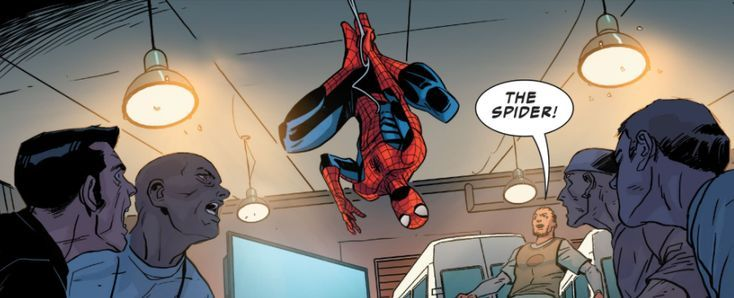

  

<h1 align="center">Hey 👋 I'm Guilherme F.S.</h1>

<h3 align="center">Developer & Editor • Building WebSenses • São Paulo, BR</h3>

## 🌐 Connect with Me

  &nbsp;&nbsp;
  &nbsp;&nbsp;
  &nbsp;&nbsp;
  &nbsp;&nbsp;
  

## 🔗 Know About Me

> I'm nands — a developer and editor who likes turning ideas into things that actually exist.
> Inspired by Spider-Man: always learning, always building, always swinging back after a bug. 🕸️

- 🕷️ Currently building **[WebSenses](https://websenses.netlify.app)**, a real-time 2D GPS inspired by the Spider-Tracker
- ⚡ Working on **[NXTSTEP](https://nxt111.netlify.app)** , an app for routine, training, studies and personal growth
- 🎬 Editing videos when I'm not coding
- 🌱 Always learning something new

## ⚙️ Tech Stack

  

## 🕸️ Projects

<table align="center">
<tr>
<td width="50%" valign="top">

### 🕷️ WebSenses
Real-time 2D GPS inspired by the Spider-Tracker.

**Status:** `building`

</td>
<td width="50%" valign="top">

### ⚡ NXTSTEP
Routine, training, studies and personal growth.

**Status:** `updating`

<!-- troque o # pelo link real -->

</td>
</tr>
</table>

